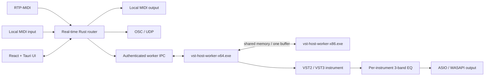

<p align="center">
  
</p>

<h1 align="center">OSCMidi</h1>

<p align="center">
  A low-latency Windows bridge for RTP-MIDI, local MIDI, OSC and isolated VST instruments.
</p>

<p align="center">
  <a href="https://github.com/GoulagmanYt/RTP-OSC-Midi-tool/actions/workflows/build-windows.yml">
    
  </a>
  
  
  
  
</p>

<p align="center">
  <a href="https://github.com/GoulagmanYt/RTP-OSC-Midi-tool/releases/latest">Download</a>
  ·
  <a href="#quick-start">Quick start</a>
  ·
  <a href="#architecture">Architecture</a>
  ·
  <a href="#development">Development</a>
</p>

---

OSCMidi connects network sessions, physical or virtual MIDI devices, OSC targets and software instruments from one desktop interface. Its Rust routing engine prioritizes the audio path, while every VST runs in a supervised sidecar process so a faulty plug-in cannot take down the main application.

> [!IMPORTANT]
> OSCMidi is designed for **Windows x64 only**. Its ASIO, WASAPI, VST and packaging layers are not intended for macOS or Linux.

## Highlights

| Area | Capabilities |
| --- | --- |
| MIDI networking | RTP-MIDI server, participant discovery and mDNS advertisement |
| Routing | RTP-MIDI and local MIDI input to MIDI Thru, OSC and VST destinations |
| VST hosting | VST2 and VST3 instruments, plug-in scanning, native editors and persistent state |
| Process isolation | Supervised x64 audio worker plus an on-demand x86 DSP worker for 32-bit instruments |
| Low-latency audio | ASIO and WASAPI backends with configurable sample rate and buffer size |
| Reliability | Bounded real-time queues, deadline metrics, heartbeat supervision and emergency MIDI reset |
| Diagnostics | Live routing status, logs, stress tests and detailed developer-only audio metrics |
| Interface | Responsive React desktop UI with English and French translations |

## Download

Download the latest build from the [GitHub Releases page](https://github.com/GoulagmanYt/RTP-OSC-Midi-tool/releases/latest).

| Package | Recommended use |
| --- | --- |
| MSI installer | Normal installation with Windows shortcuts and uninstall support |
| Portable ZIP | No installation; extract the complete archive and run `OSCMidi.exe` |

The portable package contains `OSCMidi.exe`, `vst-host-worker-x64.exe`, and `vst-host-worker-x86.exe`. Keep all three in the same directory: the application intentionally does not load VST DLLs in its own process.

> [!NOTE]
> GitHub Releases are Authenticode-signed and timestamped when the signing secrets are configured. Without them, the workflow publishes unsigned packages with an explicit warning; local builds are also unsigned by default.

## Quick start

1. Install OSCMidi with the MSI, or extract the complete portable ZIP.
2. Open **RTP-MIDI** and configure the local session name and ports.
3. Open **Routing** and select the required MIDI, MIDI Thru and OSC destinations.
4. To use a software instrument, open **Audio**, select an ASIO or WASAPI device, then choose a compatible VST2 or VST3 instrument.
5. Start the bridge and monitor its state from the dashboard.

For a first audio test, start with **48 kHz / 512 samples**. Reduce the buffer only after the complete route is stable with the selected driver and plug-in.

Use **Audio → Equalizer** to shape the selected instrument with low-shelf, parametric-mid and high-shelf bands. EQ curves are saved independently for each VST, and bypass keeps the current curve available for later use.

## Architecture



The desktop process owns configuration, routing and supervision. The worker owns the active VST instance, its native editor, the audio device and the real-time callback. Control and MIDI messages cross a versioned, authenticated local IPC channel. If the worker crashes or stops responding, the desktop interface remains available and can return the audio system to a coherent state.

More detail is available in [src-tauri/ARCHITECTURE.md](src-tauri/ARCHITECTURE.md).

## System requirements

### Runtime

- Windows 10 or Windows 11, x64.
- Microsoft Edge WebView2 Runtime.
- A WASAPI-compatible device or an installed ASIO driver.
- Optional x86 or x64 VST2/VST3 instrument plug-ins.
- A local MIDI device or RTP-MIDI peer when using those routes.

OSCMidi scans standard Windows VST locations. Unsupported architectures, effects and plug-ins that fail compatibility probing are excluded from the instrument list.

VST3 hosting is built and checked against Steinberg VST3 SDK `v3.8.1_build_84`
(commit `3cdf9ca5d1f5b1b21e0a86832aa4abe55607bd96`). VST2.4 support is a
legacy compatibility layer based on its frozen ABI: Steinberg discontinued the
VST2 SDK, so new host capabilities and conformance work target VST3.

### Development

- Node.js 20.19+ or 22.12+, with npm.
- Stable Rust toolchain installed through `rustup`.
- Visual Studio Build Tools with the x64 MSVC C++ toolchain and a Windows SDK.
- CMake.
- LLVM/Clang with `clang.exe` and `libclang.dll`.
- Git.
- The `ASIOSDK` directory included in this repository.

Install the main tools on a fresh Windows environment:

```powershell
winget install OpenJS.NodeJS.LTS
winget install Rustlang.Rustup
winget install Microsoft.VisualStudio.2022.BuildTools --override "--wait --passThru --add Microsoft.VisualStudio.Component.VC.Tools.x86.x64 --add Microsoft.VisualStudio.Component.Windows11SDK.22000"
winget install Kitware.CMake
winget install LLVM.LLVM
```

## Development

Install dependencies and start the Tauri development application:

```powershell
npm ci
npm run tauri:dev
```

The Tauri development command builds and stages the debug VST worker before starting Vite and the desktop shell.

### Common commands

| Command | Purpose |
| --- | --- |
| `npm run tauri:dev` | Build the debug worker and start the desktop application |
| `npm run lint` | Run ESLint and TypeScript checks |
| `npm test` | Run the frontend test suite once |
| `npm run build` | Build the frontend production bundle |
| `npm run tauri:build` | Build the release application and MSI |
| `npm run prepare:vst-worker:dev` | Build and stage only the debug VST worker |
| `npm run prepare:vst-worker:release` | Build and stage only the release VST worker |

### Full validation

```powershell
npm run lint
npm test
npm run prepare:vst-worker:dev

cargo fmt --manifest-path src-tauri/Cargo.toml --package osc-midi-bridge -- --check
cargo clippy --manifest-path src-tauri/Cargo.toml --all-targets --all-features -- -D warnings
cargo test --manifest-path src-tauri/Cargo.toml --all-targets --all-features

cargo fmt --manifest-path tools/diagnostics/Cargo.toml --package oscmidi-diagnostics -- --check
cargo clippy --manifest-path tools/diagnostics/Cargo.toml --target-dir tools/diagnostics/target --all-targets -- -D warnings

cargo test --manifest-path vendor/rtpmidi/Cargo.toml --all-targets
cargo test --manifest-path vendor/rack/Cargo.toml --lib --features vst3 --no-run
cargo test --manifest-path vendor/vst/Cargo.toml --all-targets --features disable_deprecation_warning
```

Developer diagnostics are kept outside the packaged application:

```powershell
cargo build --manifest-path tools/diagnostics/Cargo.toml --target-dir tools/diagnostics/target
```

## Windows release build

Run the complete local build from the repository root:

```bat
build_windows.bat
```

The script validates the toolchain, prepares frontend dependencies, runs the shared frontend, Rust, diagnostics, vendored VST/RTP-MIDI and native audio checks, builds both workers, the application and MSI, and exports the deliverables. It preserves dependency and compilation caches after success or failure. An unchanged dependency installation is reused only when its manifests, lockfile, local npm configuration and Node/npm versions match and `npm ls` reports a valid dependency tree. Progress and command output remain visible throughout the build.

```bat
build_windows.bat -Clean
build_windows.bat -CleanAfter
build_windows.bat -CleanOnly
build_windows.bat -ReinstallDependencies
build_windows_no_log.bat
clean_all.bat
```

`-Clean` removes generated build directories before running the same complete validation and packaging pipeline. `-CleanAfter` (or `-Cleanup`) runs the full build and packaging pipeline, exports the deliverables to `artifacts\`, and then cleans up all intermediate compiled libraries and build targets (`.cargo-target`, `tools\*\target`, etc.) to free disk space (~30+ GB). `-CleanOnly` (or `clean.bat` / `npm run clean`) immediately removes workspace compilation caches and intermediate build outputs without rebuilding. `-ReinstallDependencies` forces `npm ci` while keeping Rust caches. The no-log launcher runs the same pipeline without writing a build log to disk. Normal builds keep their ten most recent logs; Cargo compilation timing reports are retained in `.cargo-target/cargo-timings/`. Release optimization settings are identical in every mode.

`clean_all.bat` runs the guarded full cleanup without rebuilding. It removes repository build caches, `node_modules`, staged workers, `dist`, generated schemas, Python caches in the scripts and diagnostic/latency tools, vendored Cargo targets, `artifacts` (including logs and packages), `reports` and `build_logs`. It preserves source files, Git history, SDK checkouts, editor settings and developer-managed environments. Global npm/Rust caches outside this repository are untouched. Run `build_windows.bat` afterwards to reinstall dependencies and rebuild.

On Windows, the frontend build still runs Vite on every invocation, then preserves file and directory timestamps only when every output path and SHA-256 content hash is identical. Any changed, added, removed or renamed asset keeps the rebuilt tree's new timestamps so Cargo regenerates its embedded asset map. CI release snapshots include `dist` for the same reason. Frontend tests are restricted to `src` so archived working copies in `artifacts` are not tested again.

Successful outputs are preserved in `artifacts\`:

| Output | Description |
| --- | --- |
| `portable\` | Ready-to-run folder containing the application and both VST workers |
| `OSCMidi_*_portable.zip` | Complete portable distribution |
| `OSCMidi_*.msi` | Windows installer |
| `SHA256SUMS.txt` | Integrity hashes for the generated deliverables |
| `BUILDINFO.json` | Exact source commit and workflow run used for packages built by GitHub Actions |
| `logs\` | Ten most recent build logs |

Run `artifacts\portable\OSCMidi.exe` directly, install the MSI, or copy/extract the complete portable folder. `OSCMidi.exe` requires both architecture-specific VST workers beside it and must never be copied alone.

Before reinstalling dependencies or performing an explicit clean, the build stops Node processes that have a native `.node` module loaded from this repository's `node_modules`. This releases Windows file locks left by development servers, including servers whose command line uses a relative path. Each stopped process is logged; processes without a matching loaded module are left running. Run `powershell -NoProfile -ExecutionPolicy Bypass -File scripts/test-build-windows-processes.ps1` to check this process selection.

Explicit cleanup removes `node_modules`, Rust target directories, staged sidecars and frontend output. It refuses paths outside the repository, directory links and any directory containing Git-tracked files. Deliverables, logs, diagnostic reports, the pinned VST3 SDK checkout and developer-managed Python environments are preserved. Stale MSI/WiX outputs are removed before every packaging run so an old installer cannot be exported as a new build. `scripts/test-build-support.ps1` exercises dependency invalidation, failed installs and cleanup safeguards using temporary repositories.

## Automated releases

[Validate](.github/workflows/validate.yml) checks every pull request: frontend lint, tests, production build and npm audit on Linux with Node 20.19, 22.12 and 24; Rust dependency auditing on Linux; and the complete Windows Rust validation. It is also called by the packaging workflow. Local builds and CI execute `scripts/validate.ps1` for the same frontend and Rust checks. The application and diagnostics share `.cargo-target`; the native x64 worker shares the application's target layout.

[Build Windows App](.github/workflows/build-windows.yml) runs on pushes to `main`, version tags and manual dispatch. Packaging waits for every job in the reusable validation workflow, including dependency audits. PowerShell validation stops at the first failed native command. Dependency downloads and the pinned VST3 SDK are cached separately from validation and release compilation snapshots. Compilation keys include the compiler, runner image, manifests, build configuration and source inputs; restore prefixes reuse compatible previous snapshots. Only `main` writes these caches; pull requests restore trusted snapshots without writing branch-specific multi-gigabyte caches.

Every build checks the common version in `package.json`, `package-lock.json`, `src-tauri/tauri.conf.json`, `src-tauri/Cargo.toml` and `tools/diagnostics/Cargo.toml`:

- Pushes to `main` upload CI artifacts without creating tags or publishing releases.
- A push of `v<version>`, or a manual run with `publish_release` selected, publishes a new release after all checks pass. Manual publication creates the annotated tag if necessary.
- An existing release is never overwritten. A tag pointing to another commit is rejected; bump the version for a new release.
- `BUILDINFO.json` records the exact commit SHA and workflow run. CI artifacts are retained for 14 days.

When the repository secrets `WINDOWS_CERTIFICATE`, `WINDOWS_CERTIFICATE_PASSWORD` and `WINDOWS_TIMESTAMP_URL` are all present, the workflow verifies the Authenticode signature of the application, both VST workers and the MSI before creating a release. If all three are absent, publication continues unsigned and emits a warning; a partial signing configuration is rejected. A manual workflow run publishes only when its `publish_release` option is selected; otherwise it performs a normal unsigned validation build. Main builds do not cancel tag or manual publication runs.

## Project layout

| Path | Responsibility |
| --- | --- |
| `src/` | React UI, pages, providers, translations and frontend tests |
| `src-tauri/src/application/` | Application services exposed to Tauri commands |
| `src-tauri/src/bridge/` | MIDI routing, lifecycle and metrics |
| `src-tauri/src/audio/` | Audio engine, callbacks, plug-in lifecycle and editor integration |
| `src-tauri/src/vst_worker/` | IPC protocol and worker supervision |
| `src-tauri/src/bin/vst_host_worker.rs` | Isolated VST/audio worker entry point |
| `vendor/rack/` | Local VST3 host integration and native bridge |
| `tools/diagnostics/` | Developer-only MIDI, RTP and VST diagnostics |
| `scripts/` | Worker preparation, build and stability utilities |
| `ASIOSDK/` | ASIO SDK sources required by CPAL ASIO builds |

## Runtime data

Configuration, logs and VST states are stored under the Windows roaming application-data directory:

| Data | Path |
| --- | --- |
| Configuration | `%APPDATA%\OSCMIDI\OSCMIDI\config\config.yaml` |
| Application log | `%APPDATA%\OSCMIDI\OSCMIDI\config\app.log` |
| VST state | `%APPDATA%\OSCMIDI\OSCMIDI\config\vst_state\` |

VST state files are keyed by the selected plug-in class and architecture. Native plug-in state is authoritative. For fingerprinted plug-ins whose native state path is unsafe, OSCMidi stores a sparse fallback containing only parameters actually edited; obsolete exhaustive zero-filled snapshots are preserved with an `.invalid-*` suffix and are not restored. State is autosaved after parameter changes and checkpointed when the editor, plug-in, or application closes.

## Troubleshooting

### A plug-in is missing

Compatible x64 and bridged x86 instrument plug-ins are displayed. Effects and candidates that fail or time out during probing remain visible in the catalogue with their status but cannot be selected normally. Refresh the instrument list after installing or moving a plug-in.

### Audio drops or XRuns are reported

- Increase the audio buffer to 512 or 1024 samples.
- Prefer a native ASIO driver when one is available.
- Confirm that the selected driver really accepts the requested buffer size.
- Close other applications competing for the audio device or real-time CPU time.
- Compare the result with a lightweight known-good instrument.

If the VST processing time itself exceeds the audio period, the stable solution is a larger buffer or lower plug-in polyphony/quality.

### The portable build cannot start the VST worker

Install the MSI, run `artifacts\portable\OSCMidi.exe`, or extract the entire ZIP. Confirm that `OSCMidi.exe`, `vst-host-worker-x64.exe`, and `vst-host-worker-x86.exe` are in the same directory. Do not distribute or move the application executable on its own.

### Local development shows `ERR_CONNECTION_REFUSED`

Close every stale `OSCMidi.exe` instance, rebuild the worker and restart `npm run tauri:dev`. A previously running binary can keep an outdated WebView development URL.

### sforzando state does not restore

The host intentionally avoids sforzando's unsafe native VST3 state path, but its writable parameters are still saved and restored. Keep the ARIA resource paths valid and use its ARIA files, such as `default.ariax`, for resource-specific configuration.

## Contributing

1. Create a focused branch from `main`.
2. Keep changes scoped and preserve the worker isolation boundary.
3. Run the relevant frontend and Rust checks.
4. Include test or build evidence in the pull request description.

Review [the architecture](src-tauri/ARCHITECTURE.md) before changing the real-time audio or worker lifecycle.

## License

This repository does not currently include an explicit project license. Unless a license is added, the source code remains subject to the default copyright restrictions.
